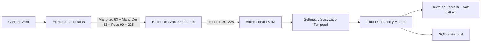

# Sistema de Reconocimiento y Traducción de Lenguaje de Señas en Tiempo Real

Este proyecto implementa una solución de visión por computadora y deep learning para capturar, registrar, entrenar y reconocer señas estáticas y dinámicas en tiempo real mediante la cámara web, traduciéndolas a texto en español y emitiendo voz sintetizada de manera local y offline.

---

## 1. Arquitectura y Tecnologías
- **Lenguaje:** Python 3.10+
- **Visión por Computadora:** OpenCV (captura de video, HUD, Canny edge detection, ventana side-by-side).
- **Extracción de Puntos Clave:** MediaPipe Holistic (landmarks 3D de manos y postura esencial) con mecanismo de contingencia (*fallback*) automático basado en Haar Cascades de OpenCV y segmentación de piel para funcionamiento offline ininterrumpido.
- **Deep Learning:** Red Neuronal Recurrente Bidireccional LSTM (TensorFlow/Keras) para modelar dependencias espaciotemporales de 30 frames y 225 características (manos + pose).
- **Base de Datos:** SQLite 3 local con índices relacionales para persistencia histórica de catálogo de señas, rutas de muestras/secuencias, traducciones acumuladas y versiones de modelos.
- **Síntesis de Voz:** `pyttsx3` ejecutado en un hilo desacoplado (*daemon thread*) para garantizar cero latencia en el procesamiento visual.

---

## 2. Estructura del Proyecto

```text
proyecto_lenguaje_senas/
├── main.py              # Punto de entrada (Lanza GUI o menú de consola con --cli)
├── interfaz_gui.py      # Interfaz Gráfica Moderna en Tkinter (Dark Theme & 6 pestañas)
├── config.py            # Rutas relativas con pathlib, hiperparámetros y umbrales
├── db.py                # Base de datos SQLite (esquema, índices y consultas)
├── landmarks.py         # Extractor unificado (MediaPipe / Fallback Haar), CLAHE y Normalización
├── captura.py           # Captura en vivo para señas estáticas y dinámicas (train/val)
├── entrenamiento.py     # Data augmentation, red LSTM / Random Forest y exportación
├── reconocimiento.py    # Inferencia en tiempo real, máquina de estados y suavizado
├── traduccion.py        # Mapeo a lenguaje natural, debounce y síntesis de voz
├── utils.py             # Medición de FPS, latencia y elementos gráficos HUD
├── etiquetas.json       # Mapeo de índices a clases de señas
├── requirements.txt     # Dependencias del proyecto
├── README.md            # Documentación técnica
├── datos/               # Almacenamiento local persistente
│   ├── db/              # Base de datos SQLite (senas.db)
│   ├── senas/           # Muestras estáticas (.jpg y landmarks .npy)
│   └── secuencias/      # Muestras dinámicas (tensores .npy de 30 frames)
└── modelos/             # Modelos entrenados (.joblib / .keras)
```

---

## 3. Esquema de Base de Datos SQLite (`senas.db`)

El sistema utiliza SQLite para el registro estructurado de datos:

| Tabla | Columnas principales | Propósito |
| :--- | :--- | :--- |
| `senas` | `id`, `nombre`, `tipo` (estatica/dinamica), `descripcion`, `fecha` | Catálogo maestro de señas registradas |
| `muestras` | `id`, `sena_id`, `conjunto` (train/val/test), `ruta_imagen`, `ruta_landmarks`, `fecha` | Registro de muestras estáticas individuales |
| `secuencias` | `id`, `sena_id`, `conjunto`, `ruta_npy`, `num_frames`, `fecha` | Registro de secuencias temporales para señas dinámicas |
| `traducciones` | `id`, `texto`, `predicciones_json`, `fecha` | Historial de oraciones traducidas y reconocidas en vivo |
| `modelos` | `id`, `ruta_modelo`, `etiquetas_json`, `accuracy`, `fecha` | Registro de versiones y métricas de modelos entrenados |
| `configuracion`| `clave`, `valor` | Parámetros de configuración persistentes |

**Índices:** Se crearon índices explícitos sobre `sena_id`, `conjunto` y `fecha` para garantizar consultas rápidas incluso con miles de registros.

---

## 4. Instalación y Puesta en Marcha

### Prerrequisitos
- Python 3.10 o superior instalado.
- Cámara web funcional.

### Pasos de instalación
1. Clonar o descargar el repositorio en su directorio de trabajo.
2. Crear un entorno virtual (recomendado):
   ```bash
   python -m venv venv
   # En Windows:
   venv\Scripts\activate
   # En Linux/macOS:
   source venv/bin/activate
   ```
3. Instalar las dependencias:
   ```bash
   pip install -r requirements.txt
   ```
4. Ejecutar la aplicación:
   ```bash
   python main.py
   ```

---

## 5. Guía de Uso del Menú

Al ejecutar `python main.py` se desplegará el menú:

```text
================================================
 SISTEMA DE RECONOCIMIENTO DE LENGUAJE DE SEÑAS
================================================
 1. Registrar señas
 2. Entrenar modelo
 3. Reconocer y traducir en vivo
 4. Capturar pruebas
 5. Ver estadísticas/registros
 0. Salir
================================================
```

### Opción 1: Registrar señas
1. Ingrese el nombre de la seña (ej. `HOLA`, `GRACIAS`, `ADIOS`).
2. Indique si es **Estática** (postura fija de mano/dedos) o **Dinámica** (movimiento durante 30 frames).
3. Se abrirá la cámara en ventana doble (cámara a la izquierda, Canny a la derecha):
   - **`[ESPACIO]`**: Para seña estática toma una muestra; para seña dinámica inicia la grabación de 30 frames continuos.
   - **`[v]`**: Alterna entre el conjunto de `ENTRENAMIENTO` y `VALIDACIÓN`.
   - **`[b]`**: Borra la última muestra capturada (tanto de disco como de SQLite).
   - **`[q]` o `[ESC]`**: Termina la sesión y vuelve al menú.

### Opción 2: Entrenar modelo
- Verifica automáticamente que existan al menos **2 clases** registradas y al menos **5 muestras por clase**.
- Aplica **Data Augmentation** espacial (ruido gaussiano, escala, traslación) y temporal.
- Entrena la red neuronal LSTM bidireccional y guarda el modelo en `modelos/modelo_senas.keras` y `etiquetas.json`.
- Registra el accuracy y la versión en SQLite.

### Opción 3: Reconocer y traducir en vivo
- Abre la cámara y carga el modelo **una sola vez en memoria**.
- Detecta landmarks y mantiene un buffer deslizante de 30 frames.
- Aplica un **umbral de confianza (>= 70%)** y **suavizado temporal por ventana** para eliminar parpadeos de detección.
- Traduce a oraciones, evita duplicados consecutivos (*debounce*), muestra el resultado en la pantalla y reproduce el sonido con voz natural (si `pyttsx3` está disponible).
- Controles:
  - **`[c]`**: Alterna el panel derecho entre filtro Canny y renderizado de Esqueleto.
  - **`[ESPACIO]`**: Guarda la oración actual en la base de datos SQLite y limpia el buffer.
  - **`[l]`**: Limpia la oración sin guardarla.
  - **`[q]` o `[ESC]`**: Sale al menú guardando automáticamente el historial.

### Opción 4: Capturar pruebas
- Permite capturar muestras destinadas a pruebas aisladas sin contaminar los datos de entrenamiento.

### Opción 5: Ver estadísticas y registros
- Muestra el total de señas, muestras estáticas, secuencias dinámicas, información del último modelo entrenado y las últimas 10 traducciones guardadas.

---

## 6. Flujo de Datos y Modelo de Deep Learning



- **Vector de entrada:** 225 dimensiones por frame (63 mano izquierda + 63 mano derecha + 99 postura corporal superior).
- **Secuencia:** 30 frames a ~30 FPS (representa ~1 segundo de movimiento de la seña).
- **Red Neuronal:**
  - Capa de Normalización por Lote (`BatchNormalization`).
  - Capa recurrente bidireccional `Bidirectional(LSTM(64, return_sequences=True))`.
  - Capa de regularización `Dropout(0.3)`.
  - Capa `LSTM(32)`.
  - Capa densa `Dense(64, activation='relu')` + `Dropout(0.2)`.
  - Capa de salida `Dense(num_clases, activation='softmax')`.

---

## 7. Recomendaciones para Ampliar el Vocabulario

1. **Iluminación uniforme y fondo neutro:** Para registrar señas limpias, procure una iluminación frontal sin contraluz.
2. **Equilibrio de clases:** Grabe un número similar de muestras por clase (ej. entre 15 y 30 muestras por seña: 80% entrenamiento, 20% validación).
3. **Variabilidad en las muestras:** Al registrar las repeticiones, alterne sutilmente la velocidad del movimiento, la distancia a la cámara y leves rotaciones de ángulo para mejorar la generalización del modelo.
4. **Extensión a señas a dos manos:** El extractor ya incluye soporte completo simultáneo para ambas manos (`left_hand_landmarks` y `right_hand_landmarks`).
5. **Configuración de frases en `traduccion.py`:** Para añadir nuevas combinaciones de oraciones, agregue las parejas o tríos de palabras en el diccionario `PATRONES_ORACIONES` dentro de `traduccion.py`.
